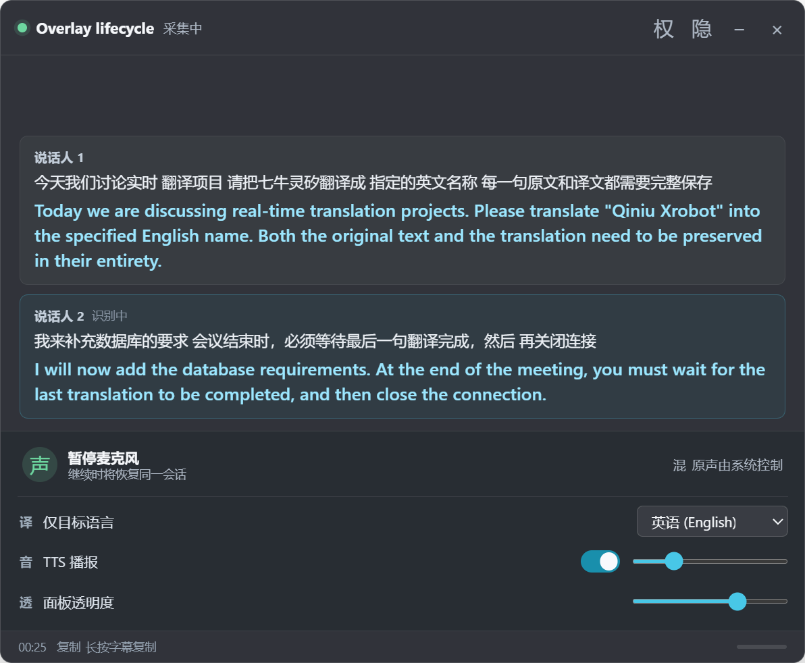

# DDtrans · Qwen 3.8 实时同传

> 视频演示：https://www.bilibili.com/video/BV15DE86xExk?t=2.4

基于 Electron 的桌面同传工具。音频经本地 Node 服务发送到 `qwen3.8-livetranslate-flash-realtime`，原文、译文和说话人分段持续显示；会议字幕、笔记及录音保存在本地。支持系统置顶悬浮字幕窗、小球保活、独立译音控制，以及原声/译音真实混音和音频路由设置。

2026 年 10 月 28 日已完成 Windows 上的真实模型与 Electron 联调：双说话人、`七牛灵矽 → Qiniu Xrobot` 热词、暂停/恢复、包含 “Thank you.” 的尾句保存，以及历史页改名、原音和译音播放均跑通。本次运行没有 JavaScript 或 console 错误。完整证据与限制见 [Qwen 3.8 协议实测记录](docs/qwen3.8-protocol-verification-2026-10-28.md)。这不代表所有语言、设备和网络环境都已验证。


## 安装与启动

开发环境需要 Node.js `>=24.13.0` 和 npm；从仓库根目录执行：

```powershell
npm ci
```

当前依赖为 Electron `45.1.0`、`ws 8.22.0`。Electron 内置 Node `24.22.1` 和 SQLite `3.53.4`，使用内置 `node:sqlite`，不需要另装数据库服务。

在根目录创建或更新自己的 `.env`。下面均为占位值，不是可用凭据：

```dotenv
DASHSCOPE_API_KEY=填入你已有的APIKey
QWEN_WS_URL=wss://<业务空间域名>/api-ws/v1/realtime?model=qwen3.8-livetranslate-flash-realtime
SERVER_PORT=0
```

如果已有的是业务空间 HTTP 兼容地址，保留同一业务空间域名和原 API Key，把协议、路径和模型查询参数改为 realtime WebSocket 地址。例如：

```text
https://<业务空间域名>/compatible-mode/v1
    ↓
wss://<业务空间域名>/api-ws/v1/realtime?model=qwen3.8-livetranslate-flash-realtime
```

程序读取显式配置的 `QWEN_WS_URL`，不会自动把 HTTP 地址转换为 WSS。启动时会检查 WSS 协议和模型参数；模型返回的 `session.updated` 还必须确认目标 3.8 模型、输出模态、目标语言、说话人分段、热词及音频格式。请求字段被忽略时会拒绝开始采集。Key 由 Node 服务用于模型连接，不写入页面或文档。

```powershell
npm start
```

Electron 主进程会自动以 `utilityProcess` 启动 `electron/service.js`，等待后台就绪后打开窗口，退出时协调会话收尾。无需手工启动第二个后端，也无需 Python。服务只监听 `127.0.0.1`；`SERVER_PORT=0` 表示自动分配端口，窗口会使用实际地址。

其他配置：

| 配置 | 行为 |
| --- | --- |
| `DASHSCOPE_API_KEY` | 使用你已有、对该业务空间有效的 API Key |
| `QWEN_WS_URL` | 完整的 Qwen 3.8 realtime WSS 地址，必填 |
| `SERVER_PORT` | 可选，默认 `0`；可指定 `0–65535` 的整数 |
| `DDTRANS_DATA_DIR` | 可选，数据库和媒体目录；默认仓库根目录下的 `data/` |

仅调试本地服务时可执行 `npm run serve`，它使用终端中的 Node；正常桌面使用执行 `npm start` 即可。旧 Python 源码已先备份至 `data/backups/legacy-python-2026-10-28.zip`，再从仓库的应用源码中移除。

## 使用

1. 设置会议名称和目标语言，选择麦克风、电脑声音或两者混合。源语言由模型自动处理。
2. 按需添加原文到译文的热词映射。“AI 语音”会读取并保存应用的译音偏好；开启时请求 `output_modalities: ["text", "audio"]`，关闭时请求 `["text"]`。新配置默认开启播报；仅支持文字的目标语言不能开启译音，也不会抹掉其他语言的已存偏好。
3. 开始同传后，按说话人显示原文与译文，笔记自动保存。暂停/恢复沿用当前模型会话；暂停时后台先补短段静音让当前句收束。
4. 点击停止后等待“已保存”。程序会等待模型的 `session.finished`，再完成尾段状态和文件收尾；不是收到几条结果就立即关闭。
5. 在记录管理页查看、搜索、改名或删除会议，在详情页查看字幕、笔记及播放录音。进行中的会议禁止通过管理接口改名或删除。

## 悬浮同传

主页点击“悬浮窗功能”即可开启系统声音同传。已有会议也可在同传页点击“悬浮窗”，保持当前采集源和模型会话继续运行。可见主页面会被销毁，独立媒体宿主持有采集、翻译和播报。

- 黑色半透明置顶窗，拖动和位置记忆；原文在上、译文在下，缓存最近 4 组，按说话人区分。
- 独立 TTS 开关与音量；隐藏字幕收成音频控制条；缩小为小球保持同传，单击小球恢复。
- 悬浮窗的“混音设置”会打开系统音频设置页；设置页可以分别调整发送到虚拟音频输出的原声与译音增益、本地监听和 TTS。
- 目标语言切换会保存当前会议并建立新会话；收音暂停/恢复沿用原模型会话。
- “返回主界面”和系统关闭悬浮窗会恢复原页面，保持当前同传；独立的“退出”才停止收音和播报，等待最后一段、笔记与音频保存，再关闭后台。
- 原声外放音量仍通过 Windows 音量混合器调整；本轮原声增益只控制 DDTrans 混音输出，不会修改其他应用的 Windows 会话音量。

## 音频路由设置

主页或悬浮窗的“系统音频设置/混音设置”会打开独立设置页。原声和 24 kHz TTS 译音进入 48 kHz、单声道混音总线；Worklet 对每个采样限幅到 `[-1, 1]`，并报告真实峰值和限幅采样计数。设置修改会在同传中即时生效，并原子保存到用户数据目录的 `audio-settings.json`。

本地监听默认只听译音，也可切换为原声与译音的混合预听；其音量仅作用于监听。译音总音量同时作用于监听和独立输出。混音可另行发送到用户选定的输出设备，供已有虚拟音频设备使用；监听和虚拟输出互不复用同一条路由。设备按 `deviceId` 保存，仅在完整 label 唯一匹配时重绑定；设备缺失会关闭该输出并提示，不会回退到默认扬声器。

如果要让 Teams、Discord 或游戏收到 DDTrans 的混音，需要先安装 Windows 虚拟音频驱动（例如 VB-CABLE 或 VoiceMeeter），在设置页选择它的虚拟播放端点，然后在外部软件的麦克风列表里选择对应的虚拟输入端点。Electron 和 Web Audio 不能单独创建一个新的 Windows 麦克风设备；本机未检测到虚拟设备，因此未完成外部会议/游戏 Capture Endpoint 实测，也没有创建 `DDTrans Virtual Microphone`。

[悬浮窗实现、需求调整与实测记录](docs/overlay-implementation-2026-10-28.md)



## 回放与采集

详情页原音和译音均通过 `HTMLAudioElement` 按需流式播放。原音有会话 WAV 时播放整场，只有段落录音时按顺序播放段落接口；译音按段落顺序播放，多段时显示“第 x/N 段”和当前播放时间。

采集使用 AudioWorklet，输出单声道、16-bit、16 kHz PCM，每帧 20 ms，即 320 个采样、640 字节。设备采样率不同时在 Worklet 内保持连续重采样。译音为 24 kHz PCM，每条音频 delta 独立解码后保存为 WAV，并使用音频播放队列播放。

Windows 电脑声音采集请求 `restrictOwnAudio: true`，在支持自身音频排除的系统上可同时实时外放 TTS，避免把译音再次送去翻译。能力不足时界面显示原因，译音保存后回放。`getDisplayMedia` 确认拿到音轨后即停止视频轨道，后续只采集音频。

完整 Electron 同传联调采用虚拟麦克风输入穿过真实 AudioWorklet 和模型。另一次真实系统声采集检查得到 18 帧、每帧 320 个采样、16 kHz，零错误且资源已释放；它只统计格式，没有录音保存或上传，不能与完整模型音频验证混为一谈。这些结果不代表所有实体设备均已验收。

段落使用原文 `source_item_id` 作为稳定键，通过 `conversation.item.created.previous_item_id` 关联不同的译文 `item_id`，不会假定两者 ID 相同。`speaker_id` 显示本次会话的说话人编号，不是姓名识别或跨会话身份认证。

## 数据与恢复

默认目录结构：

```text
data/
  translation.db                       SQLite 会话、字幕、笔记和遥测
  translation.db-wal / -shm             SQLite 运行时文件
  translation.db.pre-node-store.sqlite  旧库首次迁移前的自动备份（存在旧数据时）
  media/sessions/<session_id>/
    source.wav                         16 kHz 整场输入录音
    <segment-key-hash>.wav              24 kHz 分段译音
  probes/                              本地脱敏探针证据
  backups/legacy-python-2026-10-28.zip   旧 Python 源码本地备份
```

指定 `DDTRANS_DATA_DIR` 后，数据库和 `media/` 跟随该目录；探针脚本的日志/截图另按脚本参数或其固定输出路径保存。新会话按事件增量更新 SQLite，音频追加写入 WAV 文件，查询字幕时不返回整块音频。本次核对的真实旧库中，原音和译音 BLOB 数量均为 0；模型升级后新增会话才有本轮生成的 WAV，不应把旧记录描述为已有录音。

会话保存请求配置和 `accepted_config`、`metrics`、按 `response_id` 保留的 `usage` 快照、`event_counts`。usage 用于追踪模型原始返回，不能擅自相加当作实际计费；耗时字段也是相对开始的观测时间，不是纯算法延迟。

正常完成记为 `completed`；连接中断或结果不完整时保留已有数据并记为 `interrupted`，未获得有效输入就失败的会话可记为 `failed`。启动打开数据库时，会把上次残留的 `running` 会话及其未完成段标记为中断，不会自动接着旧模型连接翻译。

打开旧库会先建立 `translation.db.pre-node-store.sqlite`，再执行迁移。副本演练和正式应用启动后的检查都已通过：3 个会话、60 段、0 条笔记的原有列逐列保留，迁移后 31 段 `final`、29 段 `interrupted`，完整性检查为 `ok`。3 个旧会话均因含有未完整段落标记为中断。副本证据为 `data/probes/migration-check.json`，正式备份与迁移结果为 `data/probes/production-startup.json`。

## 测试与实测证据

```powershell
npm test
```

2026 年 10 月 29 日最终回归：**39/39 自动化测试通过**，`verify:desktop`、`verify:overlay`、`verify:audio-routing`、`verify:capture`、`verify:loopback` 均通过。音频路由专项包含真实 Web Audio 混音、Windows 回环和显式所选播放设备输出；本机无虚拟设备，外部会议的虚拟输入尚未实测。`npm test` 使用临时数据库和本地网络替身，不需要真实 Key，不连接模型，也不打开正式 `data/translation.db`。专项验证实际使用本机音频设备，证据写入独立测试目录。

| 证据 | 内容 |
| --- | --- |
| `data/probes/desktop-verification.json` | 主页创建、成对字幕、暂停恢复、尾段与笔记保存、历史列表 |
| `data/probes/overlay-live.json` | 最新悬浮窗真实模型验证：主窗销毁、双说话人、热词、尾句与完整退出 |
| `data/probes/overlay-verification.json` | 原生窗口生命周期、位置、字幕、TTS、语言切换与记录收尾 |
| `data/probes/loopback-isolation.json` | 系统回采排除本应用，以及译音音量/静音实际输出幅度 |
| `data/probes/electron-live.json` | Electron 页面 → AudioWorklet → Node → 真实模型；双说话人、暂停/恢复、尾句、笔记及历史页验证 |
| `data/probes/gateway-live.json` | Node 服务真实联调，状态、原译文关联、WAV 可读，`checks: "all passed"` |
| `data/probes/audio-speakers-hotwords.json` | 真实协议事件序列、双说话人和热词、音频流及结束事件 |
| `data/probes/system-capture.json` | Electron 真实系统声格式及资源释放检查，16 kHz / 320 样本每帧；无录音保存或上传 |
| `data/probes/audio-routing-verification.json` | 48 kHz 真实混音、显式所选设备/回环数值、增益比例、限幅计数、断开静音、设置保存验证 |
| `docs/audio-routing-implementation-2026-10-29.md` | 混音总线、设置保存、虚拟设备边界和本轮验证结果 |
| `docs/virtual-microphone-production-plan-2026-10-29.md` | 系统可枚举虚拟麦克风的实现、主线判断和制作计划 |
| `data/probes/migration-check.json` | 原库副本的迁移、逐列数据保留和完整性检查 |
| `data/probes/production-startup.json` | 正式旧库自动备份与迁移完成，原有字段逐列保留 |
| `docs/images/realtime-3.8-verified.png` | 真实 Electron 联调截图 |

探针是本地证据，可能不随仓库分发。协议探针的音频 payload 已替换为字节数和 SHA-256，不包含可直接回放的音频；复测命令、完整请求及各项验证范围见[协议实测记录](docs/qwen3.8-protocol-verification-2026-10-28.md)。

本机额外保留 `data/probes/fixtures/two-speakers-16k.pcm` 合成测试输入，以及 `data/probes/electron-verified/` 下独立的测试数据库和 WAV，供后续复现。它们与正式会议数据库分开存放，整个 `data/` 目录不纳入 Git。

## 当前边界

- 只实现 WebSocket。WebRTC 和 AOQ 未实际接入，没有三协议测速结果。
- 声音复刻产品代码已删除，UI 不开放；仅保留独立零音频配置 accepted 探针，没有验证真实复刻音频。
- ASR 原文存在错漏；热词译文出现 `Qiniu Xrobot` 不保证原文逐字正确。
- 配置回显、无 `error` 和有真实音频结果是不同证据。旧 `modalities: ["text"]` 曾被回显，但实际 `output_modalities` 仍为 `["text", "audio"]`；当前使用后者并核对返回值。
- 需要可用的模型网络连接和音频权限；尚未对全部语种、操作系统和声卡完成覆盖验证。

桌面闭环验证：`npm run verify:desktop`；悬浮窗专项验证：`npm run verify:overlay`；系统声音检查：`npm run verify:capture`；回采隔离与译音音量：`npm run verify:loopback`；音频设置页和路由：`npm run verify:audio-routing`；真实模型联调：`npm run verify:live -- <16k-mono-wav-or-pcm>`。专项验证使用独立测试目录；真实模型测试会上传指定测试录音。最终悬浮窗回归已确认系统剪贴板可写并能读回原文与译文；此前环境中写入失败时的提示也有回归覆盖。
