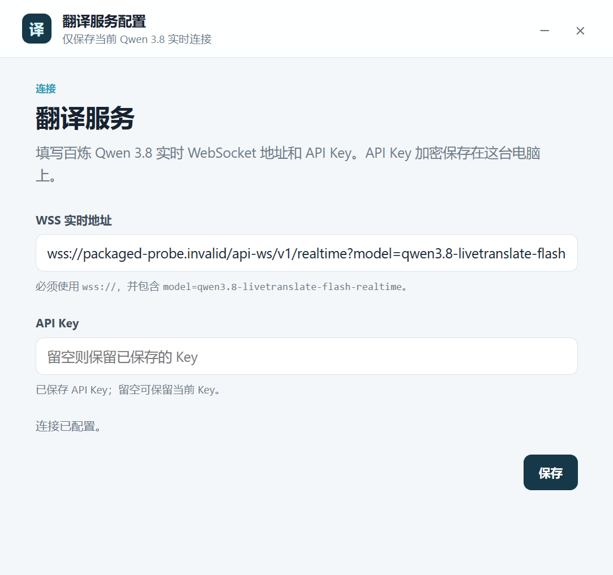

# 翻译服务连接设置

日期：2026-10-30。

安装版通过“音频设置 → 翻译服务配置”填写当前 Qwen 3.8 的实时 WSS 地址和 API Key；地址必须为 wss，且 model 为 qwen3.8-livetranslate-flash-realtime。此页面只配置当前模型。

API Key 由 Electron safeStorage 使用 Windows 本机凭据保护加密保存。渲染页面只能得到地址和 hasKey 状态，不接收已保存的明文 Key。留空保留已有 Key。开发模式继续使用原 .env；安装版从当前用户目录读取加密配置，数据库及录音位于该用户目录下的 data。

保存操作按顺序执行：校验输入、准备临时文件、等待后台确认接受、原子提交文件。同传运行或暂停时拒绝变更；保存期间阻止开始和恢复。落盘失败时恢复此前运行配置，不重启后台或改变本地页面地址。

相关验证包含配置读写、解密失败、无 Key 初始状态、空 Key 保留、落盘失败恢复、活动会话拒绝更新和后续会话使用新地址。安装版烟测使用虚构地址与 Key，不调用收费模型。

