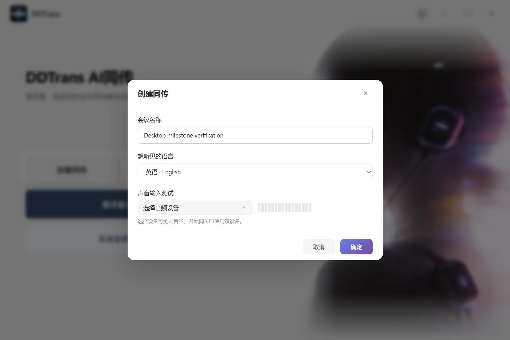
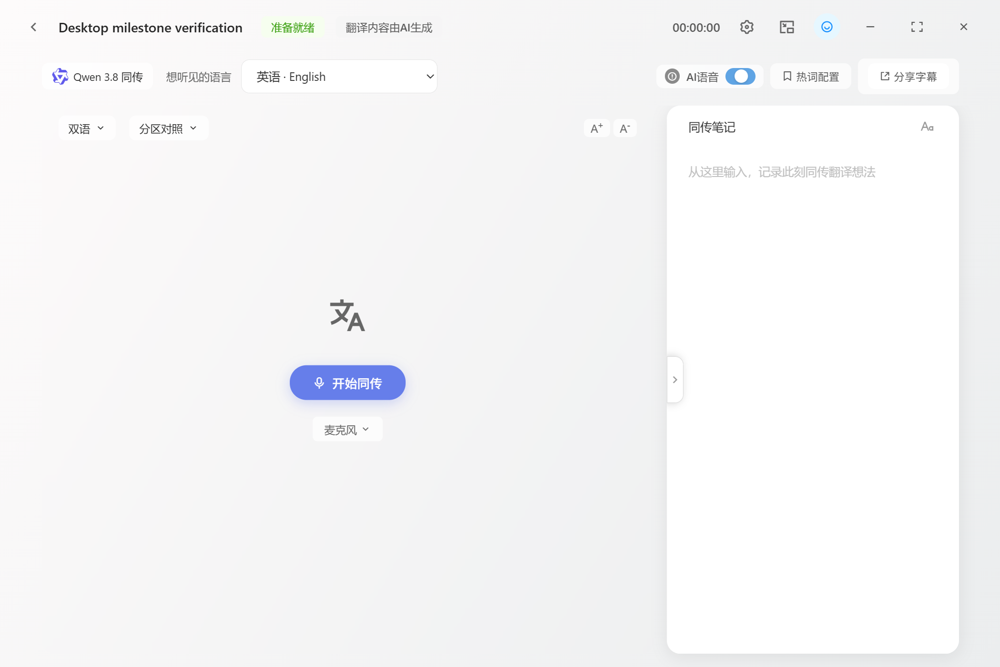

# 桌面界面与本地保存修复（2026-10-30）

本轮修复安装版离线资源、目标语言选择和热词保存，保留现有 Electron + HTML/CSS/JavaScript 技术栈。

## 页面行为

- Remix Icon 固定为 4.2.0，CSS、WOFF2 和 Apache-2.0 授权文件随应用保存于 `app/vendor/remixicon`。页面不再访问 CDN。
- 安装包包含 `resources/icons`，主页、模型标志不再引用包外文件。
- 系统设置和悬浮窗使用 Remix Icon；图标按钮保留名称、提示和无障碍标签。
- 创建同传和同传页统一使用同一套样式的原生 select，只选择“想听见的语言”。源语种自动识别，移除源语言控件和交换按钮。
- 移除 Qwen 3.8 自动识别说明的常驻占位。反馈区域在需要提示或展示保存操作时显示。

## SQLite 与热词

继续使用内置 SQLite、WAL、外键和增量 upsert。字幕和会话状态存数据库，原音和译音保存为 WAV。后台 Node utilityProcess 持有数据库；页面生命周期不承担会话存储。

数据库 schema 从 3 升到 4，仅新增 `hotwords(source PRIMARY KEY, target)` 表。`GET /api/hotwords` 读取配置，`PUT /api/hotwords` 在事务中完整替换；每条原文唯一，最多 1000 项，每项原文和译文最多 500 字。保存失败时保留原配置。

随机本地端口会改变浏览器 origin。此前的 localStorage 热词因此不能可靠地跨启动读取；当前热词随同用户数据库持久保存，主页面、悬浮窗和发言翻译统一读取这一来源。旧端口 origin 中的热词不会自动复制到数据库；如需要旧词表，可从对应历史会话的 config_json 提取。

桌面单用户场景没有远端共享数据库或多实例任务队列。MySQL + Redis 会增加安装、运维、连接和同步状态，不解决当前的鉴权、音频采集或模型断线问题。当前不引入它们。

## 验证

- 桌面真实窗口：创建同传、只选目标语种、字体加载、模型图片、两个图标、移除占位、字幕配对、暂停恢复、尾段和笔记保存。
- 悬浮窗：主页面销毁/恢复、小球、停止收尾，console 无错误。
- 热词：重开数据库后仍存在；无效或重复原文不会覆盖现有词表。
- 混音：440 Hz 原声和 997 Hz 译音的独立增益、监听、选定输出、TTS 关闭、缓冲上限与资源释放实测通过。原声静音后幅度约 0.00061（原 0.11994），译音保持约 0.07998（原 0.07991）。
- 安装包静态校验要求字体、字体授权及模型/主页图片均在 ASAR 内。安装包启动验收另检查真实页面资源加载。

本地原始报告在忽略目录 `data/probes`，不会将个人设备状态、录音或 API 凭据推送到仓库。
