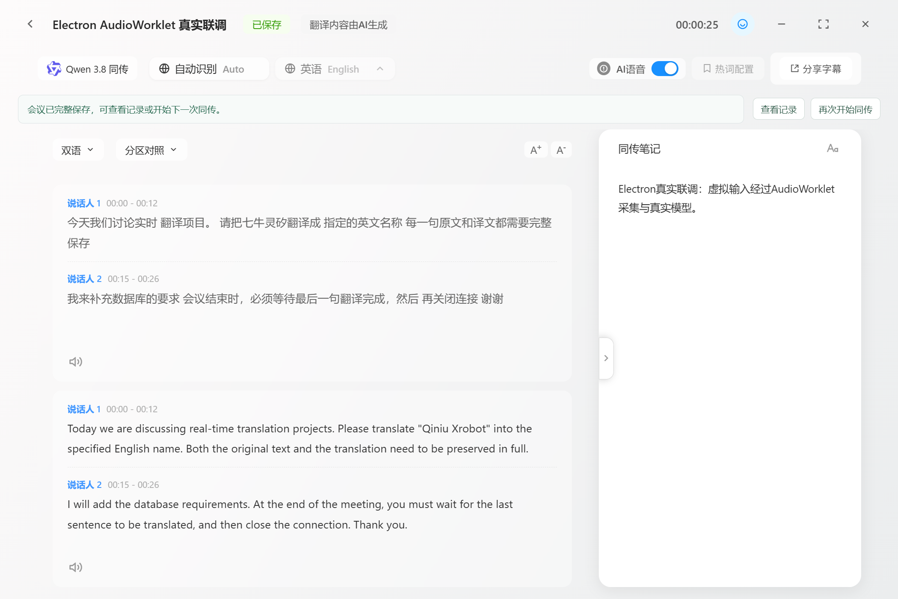

# Qwen 3.8 实时同传协议实测记录

记录日期：2026-10-28。依据当前 `electron/*.js`、前端音频链路、探针脚本与 `data/probes/*.json` 编写。本文记录本次环境中的实际结果；配置被接受、真实音频返回、界面交互通过分别说明。没有读取或记录 `.env` 中的 Key。

## 1. 已验证的结果与运行环境

真实链路为 Electron 页面 → AudioWorklet → 本地 Node HTTP/WS 服务 → 业务空间 realtime WSS → Qwen 3.8。`npm start` 自动用 Electron `utilityProcess` 托管服务，不再需要手工运行 Python 后端。

| 项目 | 本次版本或设置 |
| --- | --- |
| 桌面环境 | Windows，2026-10-28 |
| Electron | `45.1.0` |
| Electron 内置 Node | `24.22.1` |
| Electron 内置 SQLite | `3.53.4`，通过 `node:sqlite` 使用 |
| WebSocket 库 | `ws 8.22.0` |
| 终端 Node | 本机 `24.13.0`；仓库要求 `>=24.13.0`，与 Electron 内置 Node 分开 |
| 模型 | `qwen3.8-livetranslate-flash-realtime` |
| 已接入的模型传输 | WebSocket；WebRTC、AOQ 未实际接入 |

`data/probes/electron-live.json` 对应的最新完整运行已通过：两个说话人、热词、暂停/恢复、尾句 “Thank you.”、笔记保存，以及历史页改名、原音/译音播放。会话为 `completed`，两段为 `final`，页面 JavaScript 错误和本次 console 错误均为零。`scripts/verify-electron.cjs` 完成时输出 `checks: "passed"`；JSON 文件自身的 `status` 是界面文案“已保存”，不是协议状态枚举。

该 Electron 验证以双说话人录音构造虚拟麦克风流，经过应用实际的 AudioWorklet 采集路径和真实模型；它没有覆盖所有实体麦克风、系统声设备和操作系统。另有 `system-capture.json` 的真实系统声格式/释放检查，未录音或上传。`gateway-live.json` 是 Node 服务的另一轮真实联调，不是本地模型 mock。单元/集成测试为本轮 **16/16 通过**，与上述联网实测分开统计。

旧 Python 源码已先本地备份到 `data/backups/legacy-python-2026-10-28.zip`，再从应用源码中移除。连接真实模型仍需用户原有的有效 API Key。

## 2. 端点与建连确认

实测使用用户原有 Key，端点保留原业务空间域名，将 HTTP 兼容 API 地址转换为 realtime WSS。结构如下，域名以占位符表示：

```text
https://<业务空间域名>/compatible-mode/v1
wss://<业务空间域名>/api-ws/v1/realtime?model=qwen3.8-livetranslate-flash-realtime
Authorization: Bearer <用户已有的Key>
```

具体业务空间端点记录在协议探针的 `result.endpoint`。应用从 `QWEN_WS_URL` 读取完整 WSS 地址，不执行自动 HTTP 转换，也没有为了升级模型另换 Key。

握手顺序是接收 `session.created` → 发送 `session.update` → 等待 `session.updated`。不能把 WebSocket 已打开或服务端初始默认配置当作请求配置已经生效。`electron/gateway.js` 只有在返回模型严格为目标 3.8、`output_modalities` 与请求一致、目标语言一致、请求中的说话人分段字段与热词映射逐项匹配，且输入/输出格式为 PCM 16 kHz/24 kHz 后才完成 `connect()`。本轮新增回归分别构造模态、语言、speaker 分段和热词被忽略的返回，四种情况都必须拒绝启动。

## 3. 真实发送的完整 session.update

下面是 `data/probes/audio-speakers-hotwords.json` 中 `at_ms: 148` 的完整发送事件；Electron 真实联调保存的请求配置采用相同结构。这是开启 AI 语音并配置英译热词的请求，不是默认文字请求。

```json
{
  "type": "session.update",
  "session": {
    "output_modalities": ["text", "audio"],
    "audio": {
      "input": {
        "format": {
          "type": "pcm",
          "sample_rate": 16000
        },
        "turn_detection": {
          "type": "speaker_detection",
          "threshold": 0.5,
          "silence_duration_ms": 1000
        }
      },
      "output": {
        "format": {
          "type": "pcm",
          "sample_rate": 24000
        },
        "voice": "Tina"
      }
    },
    "translation": {
      "language": "en",
      "corpus": {
        "phrases": {
          "七牛灵矽": "Qiniu Xrobot"
        }
      }
    }
  }
}
```

`at_ms: 222` 收到的 `session.updated.session` 确认：模型为 3.8，`output_modalities` 为 `["text", "audio"]`，输入/输出分别为 16 kHz/24 kHz PCM，`audio.input.turn_detection.silence_duration_ms` 为 `1000`，热词映射原样存在。服务端还补充 `create_response: true`、`interrupt_response: true`，并在顶层返回相同的 `turn_detection`。

默认 UI 的 `aiVoiceEnabled` 为 `false`，构造请求时使用 `output_modalities: ["text"]`；开始前开启“AI 语音”才使用上述双模态。源语言由模型自动处理，`translation.language` 是目标语言。声音复刻的产品配置代码已删除，UI 不开放，独立探针只保留历史配置 accepted 证据。

## 4. 配置回显、默认行为和错误

以下五份探针都有 `{ "result": ..., "events": [...] }` 包装。它们的 `result.input_bytes` 和 `result.output_audio_bytes` 都是 `0`，因此只支持配置或拒绝行为的结论，不能据此宣称语音内容已验证。

| 本地证据 | 请求与观测 | 可支持的结论 |
| --- | --- | --- |
| `data/probes/config-default.json` | `session.created` 的静音阈值为 `2500 ms`；请求只给 `type: "speaker_detection"`，updated 中没有显式 silence 数值 | 2500 是本次创建会话时观察到的服务端默认值；不要从缺失字段推断 updated 仍明确确认了该值 |
| `data/probes/text-hotword.json` | `output_modalities: ["text"]`、热词和显式 `silence_duration_ms: 1000` 都在 updated 中确认 | 文字、热词和 1000 ms 配置被接受；这份零输入探针没有验证真实文字/译音内容 |
| `data/probes/legacy-fields.json` | 旧 `modalities: ["text"]` 和 `input_audio_transcription` 被回显，`errors: []`；但 `output_modalities` 仍为 `["text", "audio"]` | 不能只看无 error 或字段被 echo 就认为只输出文字；也不能据此确认独立 ASR 模型已生效 |
| `data/probes/invalid-audio-only.json` | 请求 `output_modalities: ["audio"]`，收到 nested `invalid_value` | audio-only 在本次端点被明确拒绝，支持的组合是 text 或 text+audio |
| `data/probes/voice-clone.json` | `voice: "default"`、`enable_voice_clone: true`、`voice_clone_options.frequency: "always"` 被接受；`audio.output.voice` 仍回显 Tina | 仅证明零音频配置 accepted，没有证明复刻音色、说话人相似度或真实声音输出 |

实际应用显式发送 1000 ms，避免把默认配置当作已确认的产品设置。有音频的协议探针与最终 Electron 回归验证了 text+audio；另外保留的 `electron-text.json` 记录了文字模式通过实际 AudioWorklet 输入、收到两段完整文本的早期回归。上述零输入配置探针本身仍不能代替音频验证。

audio-only 的真实错误事件如下：

```json
{
  "event_id": "event_SuAC81c2Bn2GAgDttKpcP",
  "type": "error",
  "error": {
    "code": "invalid_value",
    "message": "Invalid output_modalities parameter, must be [\"text\"] or [\"text\", \"audio\"]."
  }
}
```

错误细节在 `event.error` 内，网关必须读取 nested `code` 和 `message` 并拒绝建连或收尾等待，不能只读取顶层 `message` 然后一直等待 `session.updated`。本地网关测试覆盖 nested error 和错误模型的 reject。

## 5. 真实事件：原文、译文、说话人与音频

以下事件节选来自同一份 `audio-speakers-hotwords.json`，保留事件顺序、真实 ID 和关联字段，其余无关字段略去。

```json
[
  {
    "type": "input_audio_buffer.speech_started",
    "audio_start_ms": 0,
    "item_id": "item_XpNO1H3YlMLyDe1QFGBYT",
    "speaker_id": 1
  },
  {
    "type": "conversation.item.created",
    "item": {
      "id": "item_XpNO1H3YlMLyDe1QFGBYT",
      "role": "assistant",
      "content": [{ "type": "input_audio" }]
    }
  },
  {
    "type": "response.output_item.added",
    "response_id": "resp_Ai5gS7wvK5pvGNzDZcwxq",
    "item": { "id": "item_EoFd3lrMi3MGuq3TCFlDG" }
  },
  {
    "type": "conversation.item.created",
    "previous_item_id": "item_XpNO1H3YlMLyDe1QFGBYT",
    "item": {
      "id": "item_EoFd3lrMi3MGuq3TCFlDG",
      "role": "assistant",
      "content": []
    }
  },
  {
    "type": "response.audio_transcript.delta",
    "response_id": "resp_Ai5gS7wvK5pvGNzDZcwxq",
    "item_id": "item_EoFd3lrMi3MGuq3TCFlDG",
    "delta": "Today we"
  }
]
```

原文和译文的 `item_id` 不同。输入 item 的 role 在这次真实事件中也是 `assistant`，所以不能单靠 role 判定原文/译文；第二个输入 item 还带着指向上一条译文的 `previous_item_id`。当前组装器先识别 `input_audio` 或已知 source，再把译文 item 经 `previous_item_id` 关联至 source，按 source ID 更新同一段。

首个译音 delta 在 `3760 ms`，脱敏记录为：

```json
{
  "type": "response.audio.delta",
  "response_id": "resp_Ai5gS7wvK5pvGNzDZcwxq",
  "item_id": "item_EoFd3lrMi3MGuq3TCFlDG",
  "delta": {
    "bytes": 15360,
    "sha256": "c9481fc130be00abab6676cb385a8b5b9f2b93b65e3f685389ac98ab852ab848"
  }
}
```

线上 `delta` 是一段独立 base64 字符串；上面的对象是探针落盘时替换的字节数和哈希，不能原样发回模型或用于回放。各块必须独立解码后再拼接 PCM，不能先拼接带 padding 的 base64 字符串。输入采集为单声道 16-bit PCM，前端 AudioWorklet 使用 16 kHz、20 ms/帧；该命令行音频探针按 3200 字节/100 ms 节奏发送，不能把两条链路的帧大小混为一谈。输出是 24 kHz PCM。

`speaker_id` 来自 `input_audio_buffer.speech_started`，本次观测到 `1` 和 `2`，存储后为字符串，界面显示“说话人 1/2”。它用于本次会话内的分段标记，不是跨会话身份认证，也不能据此得出姓名、真实身份或声纹验证已完成。

## 6. 事件顺序与完整性

真实音频探针观察到的关键顺序：

| 相对开始时间（ms） | 事件或动作 |
| --- | --- |
| 148 | 收到 `session.created`，随即发送上面的 `session.update` |
| 222 | 收到 `session.updated` |
| 1282 | 第一位说话人的 `speech_started` |
| 1435 | 第一条输入 `conversation.item.created` |
| 1436 | 先收到 target 的 `response.output_item.added`，随后收到带 `previous_item_id` 的关联事件 |
| 3510 / 3527 / 3760 | 首个原文 delta / 译文 delta / 译音 delta |
| 14390 | 第一段 ASR completed、audio_transcript.done、audio.done |
| 14393 | 第一段 `response.done`，status 为 `completed` |
| 15385 | 第二位说话人的 `speech_started` |
| 15517 | 第二段输入、target added、target 关联相继到达 |
| 25628 | 客户端发送 `session.finish` |
| 26681 | 最后一段 `speech_stopped` 才到达 |
| 26835 | 尾段 ASR completed、译文 done、audio.done、response.done，最后是 `session.finished` |

这里实际出现了 output item 先于原译文关联到达；同毫秒的多条事件仍按日志数组顺序处理。ASR completed、`response.done` 和 `audio.done` 是独立完成条件，不能以任意一个替代其他条件。本地测试额外构造 response.done → ASR completed → audio.done 的排列，验证乱序最终补齐；这是合成回归，不宣称该排列在本次音频日志中同样出现。

当前实现按 source ID upsert 段落；关联前到达的译文与译音先缓冲，关联后补入原段。有界 `event_id` 缓存负责重复事件去重。开启译音时，原文 completed、response completed 和 audio.done 都满足才是 `final`；响应 status 不是 `completed` 则标记 `interrupted`。最终仍未关联的译文保留为中断段，避免丢弃已经收到的内容。

## 7. 暂停、停止和持久化

暂停时，前端暂停采集，Node 会话进入 `pausing`，约 1.2 秒内发送 12 个 100 ms 的静音块，让正在进行的句子收束后进入 `paused`。恢复继续当前模型连接。本次服务探针和 Electron 探针都观察到暂停后再次进入 `running`。

正常停止顺序：

1. 页面提交待保存笔记并停止采集，服务进入 `stopping`。
2. 网关发送 `session.finish`，继续接收原文、译文、译音和 usage 尾部事件。
3. 网关收到 `session.finished` 才完成 `finish()`，不是依靠两条消息计数。
4. 会话组装器 finalize，关闭并同步 WAV，保存最终 metrics、usage 和 event_counts，再写入最终会话状态。
5. 完成落库后才向页面发 `stopped` 并关闭模型连接。

网关等待尾段有 30 秒超时；连接错误或超时会保留已收到的数据，并按失败/中断收尾，不保证此时所有结果已齐全。`completed`、`interrupted`、`failed` 分别表达完成、已保留但中断、失败，不能把“已保存一些数据”当作完整成功。

SQLite 持续 upsert 字幕/笔记，新增音频保存为 `media/sessions/<id>/source.wav` 和按 source key 哈希命名的分段译音 WAV，不再把新会话整场音频只放内存等结束。原音为 16 kHz，译音为 24 kHz。系统声和混合模式采集中不实时外放 TTS，避免回采；译音仍保存，暂停或结束后可播放。

详情页原音、译音统一由 `HTMLAudioElement` 按需流式播放。原音有会话文件时使用 `/api/sessions/<id>/audio?type=raw` 播放整场；仅有段落录音时，按段落顺序请求 `/api/audio/<segment_id>?type=raw`。译音按序请求对应的 `type=tts` 接口，多段时显示“第 x/N 段”及当前段播放时间。详情页已删除 AudioContext 整段解码路径和旧 metadata 兼容逻辑。

会话的遥测包含：

| 字段 | 保存的内容 |
| --- | --- |
| `config_json` | 本地请求配置 |
| `accepted_config_json` | `session.updated` 接受的配置 |
| `metrics_json` | 网关相对开始时间的观测值 |
| `usage_json` | 按 `response_id` 保留的模型 usage 快照 |
| `event_counts_json` | 段落组装器去重后接收的事件计数 |

`usage` 是服务端原始返回，没有把它擅自求和换算成计费。协议探针第一段 response.done 的 usage 为 `total_tokens: 401`、`input_tokens: 166`、`output_tokens: 235`；Electron 是另一次请求，另外保存自己的快照。这些不能跨运行混加，更不能未经供应商计费语义确认就声称“本场计费总量”。

## 8. 真实音频结果、系统声格式检查与耗时

| 观测点（ms） | `audio-speakers-hotwords.json` | `gateway-live.json` |
| --- | ---: | ---: |
| WebSocket 打开 | 143 | 211 |
| 配置确认 | 222 | 289 |
| 首个原文 delta | 3510 | 3391 |
| 首个译文 delta | 3527 | 3417 |
| 首个译音 delta | 3760 | 3608 |
| 收到 `session.finished` | 26835 | 26677 |

所有数值都是各自探针/网关开始计时后的相对时间，不是纯模型算法延迟，也不是每句话最后一个字到译文的延迟。它们含建连、配置、按实时节奏发送输入、语音内容长度和网络时间；涉及暂停/恢复的运行还包含该过程。这里固定引用上面两份主样本；`electron-live.json` 会随后续真实回归更新，其性能数值以该次保存的 `metrics_json` 为准，不混入这张表。各轮运行没有控制成协议性能对比，不能用于 WebSocket、WebRTC、AOQ 三协议测速。

只有直接协议探针明确记录了 `session.finish` 的发送时刻，因此能从本轮日志计算这一次尾部等待为 `26835 - 25628 = 1207 ms`。表内约 26–30 秒的 finish 数值是全程位置，不能称作“停止耗时 30 秒”。

具体结果：

- `audio-speakers-hotwords.json`：输入 `811360` 字节 PCM，输出 `1125120` 字节译音；两个 speaker、两段完成原文/译文，`errors: []`。这份较早的音频记录尾句不含 “Thank you.”，不要把 Electron 后续结果倒写到它里面。
- `gateway-live.json`：`checks: "all passed"`，`completed` 且 `partial: false`，无 errors/warnings；输出译音 `1163520` 字节，整场原音 WAV `769804` 字节、第一段译音 WAV `691244` 字节。两段都为 `final`，有笔记，尾句包含 “Thank you.”。
- `electron-live.json`：`detail.session.status: "completed"`，两段 `speaker_id` 为 `"1"`、`"2"`，各有原文和译文、原音和译音元数据；保存 accepted_config、metrics、按 response 保留的 usage 快照及含 `session.finished` 的 event_counts。`verification.errors: []`；`history_ui.rename`、`source_playback`、`translation_playback` 均为 `true`。console 零错误由验证脚本最终输出记录，不是 JSON 中另一个同名字段。

Electron 第二段真实保存的译文为：

> I will add the database requirements. At the end of the meeting, you must wait for the last sentence to be translated, and then close the connection. Thank you.

热词成功体现在译文包含 `Qiniu Xrobot`。前一轮 Electron 回归曾把“七牛灵矽”识别为“七牛灵”，已在 `electron-live-previous-audio.json` 保留原始结果；最终一轮原文包含“七牛灵矽”。这说明不能因为单次热词译文正确就声称 ASR 原文逐字可靠，本轮没有从两位说话人的短样本计算普遍识别准确率。

独立的真实系统声检查保存于 `data/probes/system-capture.json`，结果为通过，记录内容如下。它只统计采集格式及停止后的释放状态，没有保存录音或上传模型，不是又一轮同传模型验收：

```json
{
  "source": "system-loopback",
  "frames": 18,
  "frame_samples": [320],
  "sample_rates": [16000],
  "errors": [],
  "released": true
}
```

当前 `getSystemAudioStreamOnly()` 在 `getDisplayMedia({audio: true, video: true})` 返回并确认有音轨后，立即停止所有视频轨道，仅保留音频，减少不需要的视频采集开销。

截图：



## 9. 旧库迁移与中断恢复

`data/probes/migration-check.json` 的最后一次 `checked_at` 为 `2026-10-28T10:36:02.222Z`，即北京时间 2026-10-28 18:36:02。其 mode 是 `readonly source, migration on VACUUM snapshot`：只读原库，迁移在一致性副本上进行。

| 表 | 迁移前 | 迁移后 | 检查 |
| --- | ---: | ---: | --- |
| sessions | 3 | 3 | 原有列逐列保留，记录有原列内容 SHA-256 |
| segments | 60 | 60 | 原有列逐列保留，记录有原列内容 SHA-256 |
| notes | 0 | 0 | 原有列逐列保留，记录有原列内容 SHA-256 |

迁移后段落为 31 个 `final`、29 个 `interrupted`，`backup_exists: true`，`integrity_check: "ok"`。这是对旧段落已有文本完整性的标记，不是补生成了旧数据缺失的译文。

北京时间 2026-10-28 18:41，正式 Electron 应用已启动并完成原库自动迁移。`data/probes/production-startup.json` 记录：备份 `data/translation.db.pre-node-store.sqlite` 为 53248 字节，原有表的所有列逐列相等，仍为 3 个会话、60 段、0 条笔记，完整性为 `ok`。3 个旧会话均含有未完整段，迁移后标记为 `interrupted`；它们的原文、译文和原始日期未改写。

启动恢复会把前次遗留 `running` 会话及其 `pending` 段标为 `interrupted`，保留已写字幕和媒体，而不是继续旧连接或把它们改成完成。本次真实旧库核对中，原音/译音 BLOB 数量均为 0，旧记录没有可用于回放的这两类录音；模型升级后新增会话才产生本轮保存的 WAV。迁移保留的是已有数据，不能把音频读取代码曾有兼容能力写成旧库本来有音频，也不能声称迁移补出了这些录音。

## 10. 证据路径与复现

本机保留的合成双说话人输入为 `data/probes/fixtures/two-speakers-16k.pcm`。最后一轮完整 Electron 测试的数据库与 WAV 已另存为 `data/probes/electron-verified/`，与正式会议记录分开。若使用本机样本复测，可把下面输入参数替换为该 PCM 的绝对路径。

本文引用的路径均相对仓库根目录：

| 路径 | 证据用途 |
| --- | --- |
| `data/probes/electron-live.json` | 完整 Electron 真实链路和 history_ui 结果 |
| `data/probes/electron-text.json` | 早期文字模式真实回归的只读数据库回查，两段完整文本 |
| `data/probes/electron-live-previous-audio.json` | 前一轮音频模式与 ASR 漏字样本 |
| `data/probes/gateway-live.json` | 服务真实联调、状态和 WAV 检查 |
| `data/probes/system-capture.json` | 真实系统声的 18 帧格式及释放检查，无录音保存/上传 |
| `data/probes/audio-speakers-hotwords.json` | 有音频的协议结果及真实事件序列 |
| `data/probes/config-default.json` | 服务端创建默认值与文字配置 |
| `data/probes/text-hotword.json` | 显式 1000 ms、文字及热词配置 accepted |
| `data/probes/legacy-fields.json` | 旧字段 echo 与实际模态不一致 |
| `data/probes/invalid-audio-only.json` | nested invalid_value 错误 |
| `data/probes/voice-clone.json` | 零音频的声音复刻配置 accepted |
| `data/probes/migration-check.json` | 原库副本迁移的逐列检查、备份与完整性 |
| `data/probes/production-startup.json` | 正式应用健康检查、原库迁移和原列保留验证 |
| `docs/images/realtime-3.8-verified.png` | 真实 Electron 联调截图 |
| `data/backups/legacy-python-2026-10-28.zip` | 旧 Python 源码本地归档 |

这些是本地实测产物，不保证包含在其他检出的仓库里。音频 payload 只保留 `{bytes, sha256}`，不能用日志恢复原始录音。复测需要自己准备包含两位说话人、热词和结尾“谢谢”的 16 kHz、单声道、16-bit PCM WAV（或相同格式的裸 PCM）。

离线单元/集成测试：

```powershell
npm test
# 只检查核心网关/段落/服务：
node --test tests/segments.test.cjs tests/gateway.test.cjs tests/service.test.cjs
```

真实模型复测需要自己的 `.env`。把第 3 节请求的 `session` 对象单独保存为外部 JSON 文件，不包含最外层 `type` 和 `session` 包装，再运行下面的协议探针；两个输入路径都替换为自己的文件：

```powershell
npm run probe -- --config "C:\Temp\qwen38-session.json" --input "C:\Audio\two-speakers-16k.wav" --out data/probes/replay-audio.json
```

零音频配置探针可运行 `npm run probe -- --target zh --out data/probes/replay-config.json`。没有输入音频的结果仍只支持配置层面的结论。脚本从环境配置读取 Key，不需要把 Key 写在命令行参数中。

要复现 AudioWorklet、暂停/恢复、尾部保存和历史页交互，在新 PowerShell 中设置独立临时数据目录，再运行现有验证入口：

```powershell
$probeData = Join-Path ([System.IO.Path]::GetTempPath()) ("ddtrans-replay-" + [guid]::NewGuid().ToString("N"))
New-Item -ItemType Directory -Path $probeData | Out-Null
$env:DDTRANS_DATA_DIR = $probeData
$env:SERVER_PORT = '0'
.\node_modules\.bin\electron.cmd scripts/verify-electron.cjs "C:\Audio\two-speakers-16k.wav"
```

会话数据库与媒体写入 `$probeData`，可在检查后自行清理；脚本仍会更新仓库中的 `data/probes/electron-live.json` 和 `docs/images/realtime-3.8-verified.png`。验证脚本对窗口音频设为静音，历史回放以播放时间推进检查，不等于人工听音评价音质。正常使用直接 `npm start`，若要单独查看服务入口则 `npm run serve`；服务输出实际本地 origin。

本记录没有 WebRTC/AOQ 接入或三协议性能结论，没有声音复刻音频功能通过结论，也没有跨会话说话人身份或全语种准确率保证。
